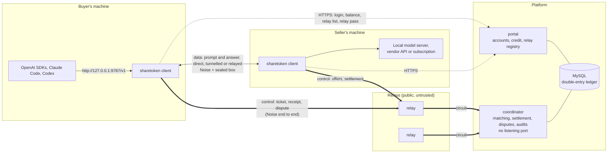

# ShareToken

**English** | [简体中文](README.zh-CN.md)

ShareToken is a peer-to-peer marketplace for LLM inference, written in Go. A user
shares the spare capacity of a model they run, of a vendor API key, or of a
Claude, ChatGPT or Gemini subscription, and earns credits; the same account
spends credits to call models that other users share. Every client exposes a
local endpoint that speaks OpenAI chat completions, OpenAI Responses and
Anthropic Messages, so OpenAI SDKs, Claude Code and Codex work by changing one
base URL.

The project's main concern is what a buyer can rely on when the machine doing the
work belongs to a stranger: that the prompt stays private on the way, that the
answer was not altered, that the bill is honest, and that the model is the one
that was advertised. See [Security](#security).

| | |
|---|---|
| Portal (hosted network, sign-up, downloads) | <https://sharetoken.app> |
| User guide | <https://sharetoken.app/docs/> |
| Developer and operator documentation | [docs/](docs/README.md) |

## How it works

Four programs, each with one job:

| Role | Program | What it does | What it does not do |
|---|---|---|---|
| User | `sharetoken` | Buyer and seller in one process: a local endpoint (OpenAI and Anthropic APIs) to buy, optional sharing of local models, API keys or subscriptions to sell. Reaches sellers directly, through a direct tunnel or through a relay, whichever works, and picks the best relay by round-trip time. | Needs no open port. |
| Relay | `relay` | Forwards encrypted libp2p traffic (circuit relay v2). There are several, and they can be run by different operators; a user can also run a private one that admits only their own accounts. | Keeps no accounts or money, and cannot read what it forwards. |
| Coordinator | `coordinator` | The accounting side: matches buyers to sellers, signs job tickets, settles receipts, judges disputes, audits sellers. | Listens on no port. It is reached only through relays. |
| Portal | `portal` | Accounts over HTTPS: sign-up and login, API tokens, device binding, credit, billing and usage, the relay registry. Serves the website, the user app and the admin console. | Takes no part in the peer-to-peer network. |

The portal and the coordinator share one MySQL database and never talk to each
other directly. Money moves only through a double-entry ledger, inside database
transactions.



One request, end to end:

1. The buyer's client asks the coordinator (through a relay) for a **ticket**. The
   coordinator picks a seller, places a hold on the buyer's credit and signs the
   ticket. The client checks that the keys and prices in the ticket are the ones
   in the seller's own signed offer.
2. The client connects to the seller by the best path that works (see
   [Connection paths](#connection-paths)) and sends the request **sealed to the
   seller's key**, in the API it came in. The prompt does not pass through the
   coordinator at all. A seller whose model server speaks another API converts
   the request and the answer ([docs/apis.md](docs/apis.md)).
3. The seller runs the model and streams the answer back, sealed to a key that
   exists only for this job, followed by a **signed receipt** over hashes of
   exactly what was sent and received.
4. The client recomputes the hashes and checks the claimed token counts. If they
   hold, it acknowledges and the coordinator settles. If not, it refuses and
   opens a **dispute**, with evidence the coordinator can check for itself.

### Connection paths

| Path | When it is used |
|---|---|
| Direct | The seller has a public address or IPv6, or hole punching (DCUtR) succeeds. |
| Direct tunnel | Both ends have turned on [direct tunnels](docs/tailnet.md) (`sharetoken tailnet on`): a WireGuard tunnel that starts over a DERP relay and moves to a direct link within seconds. No Tailscale account is needed. |
| Relay | Neither end can be reached: the traffic goes through a network relay, or through the seller's own private relay. |

The client falls back from one to the next by itself. On every path the request
is sealed the same way, so a relay or a DERP server only ever sees ciphertext.

The design is described in [docs/architecture.md](docs/architecture.md).

## Security

A marketplace like this has to assume that any party may misbehave: a seller may
run a cheaper model or pad the bill, a relay may snoop, a buyer may refuse to pay
for work that was done. The table lists what the protocol gives a buyer and the
mechanism behind each line. [docs/security.md](docs/security.md) has the full
threat model, including the seller's and the operator's side.

| What a buyer can rely on | How |
|---|---|
| The coordinator, the relays and the network cannot read the prompt or the answer | The data path runs buyer to seller. It is encrypted twice: libp2p Noise end to end (also across a relay), and a sealed box per message (ephemeral X25519, HKDF-SHA256, AES-256-GCM) bound to the job and the chunk number. |
| The answer was not altered, truncated or reordered | The seller signs a receipt over the hashes of the sealed request and of every sealed chunk. The client recomputes them from what it actually sent and received. |
| An inflated bill is refunded | The client rejects a receipt whose token counts are implausible and discloses **that one job's** key. The coordinator verifies the transcript against the seller's own signature, counts the tokens with a reference tokenizer and decides on the facts. |
| The model is the one advertised | The coordinator audits sellers at random as an ordinary buyer, through its own relays, with a few open-ended questions; its reference copy of the model checks every answer token by token. Repeated mismatches suspend the seller. |
| Even the seller cannot read the prompt (optional) | Sellers running in an AMD SEV-SNP or Intel TDX confidential VM publish a hardware quote that binds both of their keys to a measured image. A buyer can require this. |
| The books balance | A double-entry ledger in MySQL. Every movement is a balanced, journaled transfer, and the journal is replayed against the balances on startup. |
| A mailbox alone is not enough to run the platform | There are no passwords: people sign in with a short-lived code mailed to them. Administrators must also use TOTP two-step verification, which anyone else can turn on. API tokens are stored as SHA-256 only, and wrong codes are throttled. |

### What it does not protect against

These limits follow from how inference works, and it is better to know them
before relying on the network:

- **Without a TEE, the seller sees your prompt.** A model cannot run on ciphertext,
  so encryption ends at the machine that runs it. Do not send secrets to a seller
  you would not trust with them unless you require TEE sellers (`require_tee`).
- **A seller that shares a vendor API or subscription forwards your prompt to
  that vendor**, under the seller's account and that vendor's data policy.
- **Audits are statistical and need a reference.** They make cheating unprofitable
  rather than impossible, and they cover only models whose reference reports
  log-probabilities: open-weight models on a self-hosted server, DeepSeek, and
  OpenAI's non-reasoning models. For the others (Claude, Gemini) the integrity
  and billing checks above still apply, but nothing proves which model produced
  the text.
- **A CPU TEE does not cover GPU memory.** Treat GPU sellers as attested on the
  CPU side only.
- **The coordinator and the portal are single operators' services.** They cannot
  read prompts, but they do hold the ledger. Whoever runs them is trusted with
  the accounting.

To report a vulnerability, see [docs/security.md](docs/security.md#reporting-a-vulnerability).
Please do not open a public issue for it.

## Use the hosted network

1. Download the desktop app or the command-line client for your system from
   <https://sharetoken.app>. Your email address is the account; the first
   sign-in creates it.
2. Sign in and start the client:

   ```bash
   sharetoken login            # a code is mailed to you; a new address gets an account
   sharetoken up               # OpenAI-compatible endpoint at http://127.0.0.1:9787/v1
   ```

3. Point your tools at the local endpoint, with the API key that
   `sharetoken apikey -q` prints:

   ```bash
   # OpenAI SDKs and tools
   export OPENAI_BASE_URL=http://127.0.0.1:9787/v1
   export OPENAI_API_KEY=$(sharetoken apikey -q)
   # Claude Code
   export ANTHROPIC_BASE_URL=http://127.0.0.1:9787
   export ANTHROPIC_AUTH_TOKEN=$(sharetoken apikey -q)
   ```

   Codex takes the endpoint as a provider in `~/.codex/config.toml`; the
   [user guide](https://sharetoken.app/docs/use-models#codex) has the lines.
   `sharetoken skill install` also teaches Claude Code and Codex how to use the
   client.
4. To earn credits, share a model:

   ```bash
   sharetoken share detect                 # models of the local model server (Ollama by default)
   sharetoken share add qwen2.5:7b         # sell a local model
   sharetoken provider add deepseek        # or connect a vendor API with a key
   sharetoken provider login anthropic     # or a subscription: anthropic, openai, gemini, antigravity, grok
   sharetoken share add deepseek-chat -provider deepseek
   ```

5. To trade only with people you know, a seller hands out a pairing code. A
   buyer that redeems it buys only from the sellers it is paired with, and
   `pair private on` hides the seller from everyone else:

   ```bash
   sharetoken pair code                    # seller: prints a code such as ABC-DEF and an invite link
   sharetoken pair join ABC-DEF            # buyer: pair with that seller (or: sharetoken accept <link>)
   ```

6. To share for free with a friend or a colleague, become share partners. Each
   uses the other's nodes first, at no cost to either side:

   ```bash
   sharetoken partner invite               # prints a one-person code and link
   sharetoken partner join ABC-DEF
   sharetoken partner set -limit 200000    # tokens your nodes give partners per 24 hours
   ```

7. Two machines behind NAT that cannot punch through can still connect directly:
   run `sharetoken tailnet on` on both ([docs/tailnet.md](docs/tailnet.md)).

The full walkthrough is in the [user guide](https://sharetoken.app/docs/). The
command reference is [docs/guide.md](docs/guide.md).

## Run your own network

Docker Compose starts a complete network on one machine: MySQL, portal,
coordinator and one relay.

```bash
cp .env.example .env          # set DB_PASSWORD, DB_ROOT_PASSWORD, ADMIN_EMAIL, MAIL_FROM and PUBLIC_HOST
docker compose up -d --build
docker compose logs portal | grep sha256:    # the portal's certificate fingerprint
```

Then connect a client built from this tree to it:

```bash
go build -o bin/ ./cmd/sharetoken
export SHARETOKEN_PORTAL=https://<PUBLIC_HOST>:8092
bin/sharetoken login -email alice@example.com -portal-pin sha256:<fingerprint>
bin/sharetoken up
```

[docs/self-hosting.md](docs/self-hosting.md) explains the settings, how to put the
portal behind a real certificate, how to add relays on other machines, and what
to back up.

## Build and test

Requirements: Go 1.27.4 or newer, and Docker for the tests (they run against MySQL 8.4).

```bash
go build -o bin/ ./cmd/...        # sharetoken, relay, coordinator, portal, mailserver
scripts/test/test.sh ./...             # starts MySQL 8.4 in Docker, then go test
scripts/dev/demo-local.sh             # a whole network on 127.0.0.1 with a real model (needs Ollama)
```

The demo runs two relays, a portal, a coordinator and three users. It shows a
seller that inflates its usage being caught and refunded on evidence, the request
failing over to an honest seller, an audit suspending the cheat, and a client
switching relays when one dies.

[docs/development.md](docs/development.md) covers the desktop app, release
packages and the browser-driven UI tests.

## Repository layout

```
cmd/            the five programs: sharetoken, relay, coordinator, portal, mailserver
internal/       all library code
  protocol/       wire messages, signing encodings, stream framing
  box/            sealed-box encryption between buyer and seller
  receipt/        signed receipts and their verification
  evidence/       deciding disputes from disclosed evidence
  attest/         TEE attestation (SEV-SNP, TDX)
  audit/          random audits against a reference model
  tokens/         token counting for disputes and audits
  p2p/            libp2p hosts, keys, relay selection, link quality
  relay/          the relay and its admission control
  relaypass/      short-lived passes that admit a device to a relay
  client/         the user client: daemon, local API, embedded UI
  buyer/          buying: tickets, sealed requests, receipt checks, disputes
  node/           selling: offers, serving ticketed jobs
  provider/       vendor APIs and subscriptions as model sources (API key or OAuth), warm-up
  apicompat/      converting between chat completions, Messages and Responses
  modelinfo/      context windows, output limits and reasoning levels of known models
  tailnet/        direct tunnels (WireGuard over DERP, then direct)
  warmup/         starting Claude and ChatGPT usage windows early
  agentskill/     the skill that teaches coding agents to use the client
  coordinator/    matching, settlement, disputes, node records
  ledger/         the double-entry credit ledger
  accounts/       users, tokens, devices, relay registry (shared database)
  portal/         HTTP API, website, user app, admin console
  mailer/         outbox, delivery, inbound mail, verification codes
  canon/ cli/ config/ mysqldb/ secfile/ totp/ version/     shared helpers
gui/            desktop shell (Wails), a separate Go module
test/           end-to-end tests over real libp2p hosts
configs/        example configuration files
docker/         container entry point (see Dockerfile, docker-compose.yml)
scripts/        build, packaging, test and demo scripts
docs/           documentation, English and 简体中文
```

## Documentation

| Document | Contents |
|---|---|
| [docs/architecture.md](docs/architecture.md) | Roles, key design decisions, the database, honest limits |
| [docs/security.md](docs/security.md) | Threat model, guarantees and their mechanisms, reporting a vulnerability |
| [docs/guide.md](docs/guide.md) | User commands, operator commands, local API, portal HTTP API |
| [docs/self-hosting.md](docs/self-hosting.md) | Running a network with Docker Compose |
| [docs/configuration.md](docs/configuration.md) | Configuration files of the server programs |
| [docs/providers.md](docs/providers.md) | Selling vendor APIs and subscriptions: provider kinds, keys and OAuth |
| [docs/apis.md](docs/apis.md) | The three model APIs (chat completions, Messages, Responses): passing through, converting, billing |
| [docs/tailnet.md](docs/tailnet.md) | Direct tunnels between machines behind NAT: how they work, settings, QUIC or TCP, limits |
| [docs/warmup.md](docs/warmup.md) | Warm-up: starting Claude and ChatGPT usage windows early |
| [docs/desktop.md](docs/desktop.md) | The desktop app: structure, local API, packaging |
| [docs/mail.md](docs/mail.md) | The mail server: verification codes, delivery, DNS |
| [docs/versioning.md](docs/versioning.md) | Release versions, interface versions, upgrade rules |
| [docs/i18n.md](docs/i18n.md) | Languages of the site, the portal and the client |
| [docs/development.md](docs/development.md) | Building, testing and packaging |

## License

ShareToken is released under the [MIT License](LICENSE).
