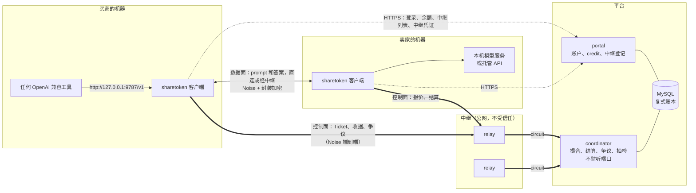

# ShareToken

[English](README.md) | **简体中文**

ShareToken 是一个用 Go 写的点对点大模型推理市场。用户把自己运行的模型（或自己付费的托管 API）的闲置能力共享出去赚 credit，同一个账户也可以花 credit 调用别人共享的模型。每个客户端都在本机提供一个 OpenAI 兼容端点，现有工具只需改一个 base URL。

这个项目最关心的问题是：干活的机器属于陌生人时，买家能依赖什么。具体是四件事：prompt 在途中不被别人看到，答案没有被改动，账单是真实的，模型就是对方声称的那个。详见[安全性](#安全性)。

| | |
|---|---|
| 门户（托管网络、注册、下载） | <https://sharetoken.app> |
| 用户指南 | <https://sharetoken.app/docs/> |
| 开发与运维文档 | [docs/zh-CN/](docs/zh-CN/README.md) |

## 工作方式

四个程序，各管一件事：

| 角色 | 程序 | 做什么 | 不做什么 |
|---|---|---|---|
| 用户 | `sharetoken` | 一个进程同时是买家和卖家：本机的 OpenAI 兼容端点用来买，可选共享本机模型或托管 API 用来卖。按往返延迟选最优中继。 | 不需要开放端口。 |
| 中继 | `relay` | 转发加密的 libp2p 流量（circuit relay v2）。中继有多个，可以由不同运营方部署。 | 不存账户和钱，读不到转发的内容。 |
| 协调器 | `coordinator` | 记账一侧：撮合买卖双方、签发作业 Ticket、按收据结算、裁决争议、抽检卖家。 | 不监听任何端口，只能经中继访问。 |
| 门户 | `portal` | 基于 HTTPS 的账户服务：注册登录、API token、设备绑定、credit、账单与用量、中继登记。自带官网、用户页面和管理控制台。 | 不参与点对点网络。 |

门户和协调器共用一个 MySQL 数据库，彼此不直接通信。钱只通过复式账本、在数据库事务里移动。



一次请求的全过程：

1. 买家的客户端经中继向协调器申请一张 **Ticket**。协调器选出卖家，冻结买家的 credit，并给 Ticket 签名。客户端核对 Ticket 里的密钥和价格与卖家自己签名的报价一致。
2. 客户端连接卖家，能直连就直连，否则走中继，然后把请求**用卖家的公钥封装加密**后发过去。prompt 完全不经过协调器。
3. 卖家运行模型，把答案流式返回。答案用只属于这一单的密钥封装，最后附一张**签名收据**，内容是实际收发字节的哈希。
4. 客户端重新计算哈希，并核对收据声称的 token 数。相符就确认，协调器随即结算。不符就拒签并发起**争议**，同时提交协调器可以独立核验的证据。

设计说明见 [docs/zh-CN/architecture.md](docs/zh-CN/architecture.md)。

## 安全性

这样的市场必须假设任何一方都可能作恶：卖家可能换成便宜的模型或者虚报用量，中继可能偷看，买家可能拿到结果后不认账。下表列出协议给买家的保证和对应的机制。完整的威胁模型（包括卖家一侧和运营方一侧）见 [docs/zh-CN/security.md](docs/zh-CN/security.md)。

| 买家可以依赖的 | 机制 |
|---|---|
| 协调器、中继和网络都读不到 prompt 和答案 | 数据面是买家到卖家的通道，有两层加密：libp2p Noise 端到端（经中继时也是），以及每条消息一次的封装加密（临时 X25519、HKDF-SHA256、AES-256-GCM），密文绑定到作业和分块序号。 |
| 答案没有被篡改、截断或重排 | 卖家对封装后的请求和每个分块的哈希签发收据，客户端用自己实际收发的字节重新计算。 |
| 虚报用量会被退款 | 收据里的 token 数不合理时，客户端拒签并交出**这一单**的密钥。协调器对照卖家自己的签名核验全文，用参考分词器数 token，按事实裁决。 |
| 模型就是声称的那个 | 协调器以普通买家的身份随机抽检卖家，并在自己的参考模型上重放同一个请求。连续不符的卖家被暂停接单。 |
| 连卖家也读不到 prompt（可选） | 运行在 AMD SEV-SNP 或 Intel TDX 机密虚拟机里的卖家会公布硬件 quote，把它的两把密钥绑定到一个可度量的镜像上。买家可以要求只用这类卖家。 |
| 账是平的 | MySQL 里的复式账本：每笔资金变动都是一次平衡的、写入日志的转账，启动时回放日志与余额对账。 |
| 只拿到邮箱不足以控制平台 | 没有密码：用发到邮箱的短时验证码登录。管理员还必须开启 TOTP 两步验证，其他人也可以开启；API token 只存 SHA-256；验证码输错有限流。 |

### 它不能防什么

这些限制来自推理本身的工作方式，使用网络之前应该先知道：

- **没有 TEE 时，卖家能看到你的 prompt。** 模型不能在密文上运行，加密只能保护到运行模型的那台机器为止。不要把机密发给你信不过的卖家，除非你要求只用 TEE 卖家（`require_tee`）。
- **转售托管 API 的卖家会把你的 prompt 转发给那家服务商**，用的是卖家的账号，适用那家服务商的数据政策。
- **抽检是概率性的，而且需要参考模型。** 它让作弊无利可图，但不能让作弊不可能发生。它只覆盖协调器持有参考副本的模型，也就是开源权重模型。对闭源的托管模型，上面的完整性和计费检查仍然有效，但没有任何手段能证明文本是哪个模型生成的。
- **CPU TEE 不保护 GPU 显存。** GPU 卖家只能视为 CPU 一侧经过证明。
- **协调器和门户各由一个运营方运行。** 它们读不到 prompt，但账本在它们手里，所以运营方在记账上是受信任的。

报告漏洞的方式见 [docs/zh-CN/security.md](docs/zh-CN/security.md#报告漏洞)，请不要为此开公开 issue。

## 使用托管网络

1. 在 <https://sharetoken.app> 下载对应系统的桌面应用或命令行客户端。邮箱就是账户，第一次登录时自动创建。
2. 登录并启动客户端：

   ```bash
   sharetoken login            # 验证码发到你的邮箱；新邮箱会自动创建账户
   sharetoken up               # OpenAI 兼容端点 http://127.0.0.1:9787/v1
   ```

3. 把任何 OpenAI 兼容工具的 base URL 指向 `http://127.0.0.1:9787/v1`，API key 填 `sharetoken apikey -q` 打印的值。
4. 想赚 credit 就共享一个模型：

   ```bash
   sharetoken share detect                 # 列出本机模型服务（默认 Ollama）的模型
   sharetoken share add qwen2.5:7b         # 出售本机模型
   sharetoken provider add deepseek        # 或者用 API key 接入托管 API
   sharetoken share add deepseek-chat -provider deepseek
   ```

5. 想把一批买家留给自己，卖家可以发出配对码。买家兑换后，只向和它配对的卖家购买：

   ```bash
   sharetoken pair code                    # 卖家：打印一个配对码，例如 K7QF-2MXA-9RTD-H3WC
   sharetoken pair join K7QF-2MXA-9RTD-H3WC   # 买家：和这个卖家配对
   ```

完整步骤见[用户指南](https://sharetoken.app/docs/)，命令参考见 [docs/zh-CN/guide.md](docs/zh-CN/guide.md)。

## 自己运行一个网络

Docker Compose 可以在一台机器上启动完整的网络：MySQL、门户、协调器和一个中继。

```bash
cp .env.example .env          # 填写 DB_PASSWORD、DB_ROOT_PASSWORD、ADMIN_EMAIL、MAIL_FROM 和 PUBLIC_HOST
docker compose up -d --build
docker compose logs portal | grep sha256:    # 门户证书的指纹
```

然后用本仓库构建的客户端连上去：

```bash
go build -o bin/ ./cmd/sharetoken
export SHARETOKEN_PORTAL=https://<PUBLIC_HOST>:8092
bin/sharetoken login -email alice@example.com -portal-pin sha256:<指纹>
bin/sharetoken up
```

各项设置、怎样给门户换成正式证书、怎样在其他机器上加中继、需要备份什么，见 [docs/zh-CN/self-hosting.md](docs/zh-CN/self-hosting.md)。

## 构建与测试

需要 Go 1.26 或更新版本；测试需要 Docker（测试在 MySQL 8 上运行）。

```bash
go build -o bin/ ./cmd/...        # sharetoken、relay、coordinator、portal、mailserver
scripts/test/test.sh ./...             # 在 Docker 里启动 MySQL 8，然后 go test
scripts/dev/demo-local.sh             # 在 127.0.0.1 上用真实模型跑完整网络（需要 Ollama）
```

演示脚本启动两个中继、门户、协调器和三个用户，演示的内容有：虚报用量的卖家被抓并按证据退款，请求自动切换到诚实的卖家，抽检暂停作弊者，中继宕机后客户端自动切换。

桌面应用、发布包和浏览器驱动的界面测试见 [docs/zh-CN/development.md](docs/zh-CN/development.md)。

## 仓库结构

```
cmd/            五个程序：sharetoken、relay、coordinator、portal、mailserver
internal/       全部库代码
  protocol/       线上消息、签名编码、流的分帧
  box/            买家与卖家之间的封装加密
  receipt/        签名收据及其校验
  evidence/       根据披露的证据裁决争议
  attest/         TEE 证明（SEV-SNP、TDX）
  audit/          对照参考模型的随机抽检
  tokens/         争议和抽检用的 token 计数
  p2p/            libp2p 主机、密钥、中继选择、链路质量
  relay/          中继及其准入控制
  relaypass/      让设备获准使用中继的短期凭证
  client/         用户客户端：daemon、本机 API、内嵌界面
  buyer/          买：Ticket、封装请求、收据校验、争议
  node/           卖：报价、处理持有 Ticket 的作业
  provider/       把托管 API 作为模型来源（API key 或 OAuth）
  coordinator/    撮合、结算、争议、节点记录
  ledger/         复式 credit 账本
  accounts/       用户、token、设备、中继登记（共用数据库）
  portal/         HTTP API、官网、用户页面、管理控制台
  mailer/         发件箱、投递、收信、验证码
  canon/ cli/ config/ mysqldb/ secfile/ totp/ version/     公共辅助包
gui/            桌面窗口壳（Wails），独立的 Go module
test/           基于真实 libp2p 主机的端到端测试
configs/        配置文件样板
docker/         容器入口脚本（见 Dockerfile、docker-compose.yml）
scripts/        构建、打包、测试和演示脚本
docs/           文档：英文和简体中文
```

## 文档

| 文档 | 内容 |
|---|---|
| [architecture.md](docs/zh-CN/architecture.md) | 角色、关键设计、数据库、诚实的边界 |
| [security.md](docs/zh-CN/security.md) | 威胁模型、各项保证及其机制、报告漏洞 |
| [guide.md](docs/zh-CN/guide.md) | 用户命令、运维命令、本机 API、门户 HTTP API |
| [self-hosting.md](docs/zh-CN/self-hosting.md) | 用 Docker Compose 运行一个网络 |
| [configuration.md](docs/zh-CN/configuration.md) | 服务端程序的配置文件 |
| [providers.md](docs/zh-CN/providers.md) | 出售托管 API：厂商类型、API key 和 OAuth |
| [desktop.md](docs/zh-CN/desktop.md) | 桌面应用：结构、本机 API、打包 |
| [mail.md](docs/zh-CN/mail.md) | 邮件服务：验证码、投递、DNS |
| [versioning.md](docs/zh-CN/versioning.md) | 发布版本、接口版本、升级规则 |
| [i18n.md](docs/zh-CN/i18n.md) | 官网、门户和客户端的语言 |
| [development.md](docs/zh-CN/development.md) | 构建、测试和打包 |

## 许可证

ShareToken 以 [MIT 许可证](LICENSE) 发布。
